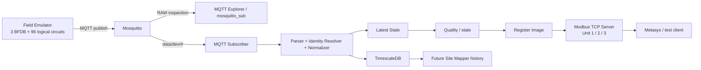
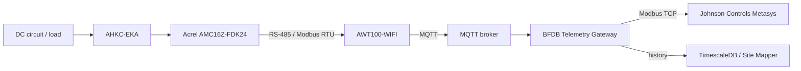

# BFDB Telemetry Gateway

Industrial telemetry gateway PoC for converting asynchronous BFDB electrical telemetry delivered over MQTT into:

1. **RAW MQTT data that can be inspected directly**;
2. **Latest State** for deterministic current values;
3. **TimescaleDB history** for historical queries and future Site Mapper consumption;
4. **read-only Modbus TCP** for Johnson Controls Metasys or another industrial Modbus client.

> **Project status:** the emulated vertical slice is executable and automatically tested. It is not yet a field-closed production integration. Real AMC16Z-FDK24/AWT100 identity mapping, real hardware substitution, all failure scenarios, and Metasys commissioning remain open.

---

## Documentation readiness

Documentation for the current project stage is **all GREEN**. GREEN here means the repository contains a canonical, executable, reviewable document for the area; it does **not** mean that an external field gate has already been executed.

| Area | Documentation status |
|---|---|
| Executive explanation | ✅ GREEN |
| Developer onboarding | ✅ GREEN |
| Start/run procedure | ✅ GREEN |
| RAW MQTT / TSDB / Modbus | ✅ GREEN |
| Pinggy + MQTT Explorer | ✅ GREEN |
| Credential recovery | ✅ GREEN |
| Architecture | ✅ GREEN |
| 4×24 identity model | ✅ GREEN |
| Historical evidence | ✅ GREEN |
| Troubleshooting | ✅ GREEN |
| PoC vs production boundary | ✅ GREEN |
| Metasys commissioning documentation | ✅ GREEN |
| Real hardware documentation | ✅ GREEN |
| Production runbook | ✅ GREEN |
| SLO / monitoring / DR documentation | ✅ GREEN |
| Release validation receipt | ✅ GREEN |

Canonical matrix: [Documentation Readiness](docs/00-project/DOCUMENTATION-READINESS.md).

The distinction remains explicit:

```text
Documentation readiness = GREEN
Actual Metasys field commissioning = pending
Actual real-hardware identity proof = pending
Production promotion = pending
```

---

## What this project does

The gateway separates four concerns that must not be coupled:

```text
MQTT         = asynchronous source / push
Latest State = best current known values
TimescaleDB  = historical observations
Modbus TCP   = synchronous polling surface
```

**Modbus never queries MQTT or TimescaleDB synchronously.** It reads an in-memory register image derived from Latest State.



### Target physical chain



The current emulator replaces the field source above the MQTT broker boundary. It is a test source, not a claim of complete vendor-device fidelity.

---

# System scale

Current PoC scale:

| Dimension | Value |
|---|---:|
| BFDB | 3 |
| Logical circuits per BFDB | 96 |
| Total circuits | 288 |
| Metrics per circuit | 4 |
| Metrics | Voltage, Current, Power, Energy |
| Logical telemetry values | 1,152 |
| 16-bit registers per FLOAT32 | 2 |
| Telemetry registers across Unit IDs 1/2/3 | 2,304 |

---

# MQTT model

Topics:

```text
data/dev/EMU-BFDB-01
data/dev/EMU-BFDB-02
data/dev/EMU-BFDB-03
```

Representative payload:

```json
{
  "msgid": "2289",
  "method": "update",
  "sn": "EMU-BFDB-03",
  "timestamp": 1790371605,
  "sendtime": 1790371605,
  "version": 1,
  "reported": {
    "0_2_1": {
      "state": "ONLINE",
      "U1": "13.82",
      "U2": "0.00",
      "I1": "3.46",
      "I2": "0.00",
      "P1": "47.83",
      "P2": "0.00",
      "EP1": "0.5074",
      "EP2": "0.00"
    }
  }
}
```

The MQTT **topic and payload are separate**. The project does not invent a JSON wrapper such as `{"topic":...,"payload":...}`.

## Corrected 24-position point identity

The emulator now respects a 24-position panel boundary:

```text
Logical circuits  1..24  -> 0_1_1 .. 0_1_24
Logical circuits 25..48  -> 0_2_1 .. 0_2_24
Logical circuits 49..72  -> 0_3_1 .. 0_3_24
Logical circuits 73..96  -> 0_4_1 .. 0_4_24
```

Therefore the corrected emulator rejects:

```text
0_1_25
0_1_49
0_1_96
0_5_1
```

The gateway reconstructs the stable logical circuit with:

```text
circuitId = ((panelIndex - 1) * 24) + position
```

Examples:

```text
0_1_24 -> Circuit 24
0_2_1  -> Circuit 25
0_3_1  -> Circuit 49
0_4_24 -> Circuit 96
```

Groups 3 and 4 are **synthetic emulator groups**. Their exact correspondence to the real frame-B namespace remains field-TBD.

## Partial updates

MQTT messages may be partial.

A point can contain:

```json
{"state":"ONLINE"}
```

without V/I/P/E.

Contract:

```text
missing field != zero
missing field = not updated
explicit "0.00" = real zero
```

Latest State merges per attribute and keeps the previous metric when the new patch omits it.

---

# Fastest way to run it

## Requirements

Recommended development environment:

- Docker Desktop / Docker Engine with Docker Compose;
- WSL/Linux/macOS shell for the documented Bash commands;
- Python 3 only if using the local Modbus reader outside Docker;
- OpenSSH client for Pinggy remote access;
- MQTT Explorer or another MQTT client if desired.

Check:

```bash
docker --version
docker compose version
python3 --version
ssh -V
```

## 1. Clone / enter the repository

```bash
git clone https://github.com/thradexIT/bfdb-telemetry-gateway.git
cd bfdb-telemetry-gateway
```

If the repository is already cloned:

```bash
git pull
```

See all helper commands:

```bash
make help
```

---

# Option A — Local lab, quickest smoke test

Start the local stack:

```bash
make up
```

Equivalent command:

```bash
docker compose up -d --build
```

Check services:

```bash
make ps
```

Expected services:

```text
mosquitto
timescaledb
telemetry-gateway
field-emulator
```

Default ports:

| Service | Host port |
|---|---:|
| MQTT / Mosquitto | 1883 |
| PostgreSQL / TimescaleDB | 5432 |
| Modbus TCP lab | 1502 |

Follow logs:

```bash
make logs
```

Healthy log markers include:

```text
EMULATOR_READY
MQTT_TX
MQTT_CONNECTED
MQTT_RX
TSDB_CONNECTED
GATEWAY_READY
MODBUS_LISTEN
```

---

# See the RAW MQTT data

The easiest repository command is:

```bash
make raw
```

The script automatically discovers the Docker Compose network and subscribes to:

```text
data/dev/#
```

Expected topics:

```text
data/dev/EMU-BFDB-01
data/dev/EMU-BFDB-02
data/dev/EMU-BFDB-03
```

With the corrected identity model, inspect the `reported` keys. Across cycles you should see:

```text
0_1_1 .. 0_1_24
0_2_1 .. 0_2_24
0_3_1 .. 0_3_24
0_4_1 .. 0_4_24
```

You should **not** see `0_1_96`.

Press `Ctrl+C` to stop watching MQTT.

---

# See the historical data in TimescaleDB

Quick command:

```bash
make tsdb
```

Equivalent SQL command:

```bash
docker compose exec timescaledb \
  psql -U bfdb -d bfdb \
  -c "SELECT observed_at,bfdb_id,circuit_id,raw_point_id,voltage_v,current_a,power_w,energy_kwh
      FROM telemetry_samples
      ORDER BY observed_at DESC
      LIMIT 20;"
```

This lets you compare:

```text
RAW MQTT raw_point_id
        ↓
logical circuit_id
        ↓
V / I / P / E historical row
```

---

# See the Modbus TCP projection

Quick smoke:

```bash
make modbus
```

Equivalent:

```bash
python3 tools/modbus-reader/read.py \
  --host 127.0.0.1 \
  --port 1502 \
  --unit 1 \
  --circuit 1
```

Other BFDBs:

```bash
python3 tools/modbus-reader/read.py --host 127.0.0.1 --port 1502 --unit 2 --circuit 1
python3 tools/modbus-reader/read.py --host 127.0.0.1 --port 1502 --unit 3 --circuit 1
```

On Windows PowerShell, use one line and `python` if that is how Python is installed:

```powershell
python tools/modbus-reader/read.py --host 127.0.0.1 --port 1502 --unit 3 --circuit 1
```

## Modbus mapping

| Unit ID | Logical BFDB |
|---:|---|
| 1 | BFDB-01 |
| 2 | BFDB-02 |
| 3 | BFDB-03 |

For circuit `c`:

```text
base = (c - 1) * 8

base+0..1  Voltage
base+2..3  Current
base+4..5  Power
base+6..7  Energy
```

Current PoC baseline:

- read-only;
- lab port `1502`;
- production port proposal `502`;
- FC04 baseline pending final Metasys confirmation;
- IEEE-754 FLOAT32;
- high-word-first / big-endian baseline pending commissioning.

---

# Option B — Authenticated MQTT + remote Pinggy access

Use this flow when someone else must open **their own MQTT Explorer** and observe your running emulator over the Internet.


## 1. Generate the MQTT credentials

Canonical command:

```bash
make remote-setup
```

Equivalent:

```bash
bash scripts/setup-remote-review.sh
```

The historical command still works for compatibility:

```bash
bash scripts/setup-ngrok-review.sh
```

The setup creates:

```text
.env.remote
infra/mosquitto/secrets/passwd
```

Both are ignored by Git.

Three broker identities are created:

| Username | Permission |
|---|---|
| `bfdb-emulator` | publish `data/dev/#` |
| `bfdb-gateway` | read `data/dev/#` |
| `bfdb-reviewer` | read-only `data/dev/#` |

The setup prints the reviewer password directly in the terminal.

## 2. How to recover the reviewer password later

Recommended helper:

```bash
make remote-creds
```

It prints only what the reviewer needs:

```text
Username: bfdb-reviewer
Password: <current reviewer password>
Topic:    data/dev/#
```

Directly from the env file:

```bash
grep MQTT_REVIEWER_PASSWORD .env.remote
```

Example:

```text
MQTT_REVIEWER_PASSWORD=xxxxxxxxxxxxxxxx
```

That value is the MQTT Explorer password.

To inspect all generated local credentials:

```bash
cat .env.remote
```

Do **not** send the whole file to the reviewer. Share only the `bfdb-reviewer` credentials.

## 3. Start the authenticated stack

Recommended:

```bash
make remote-up
```

Equivalent:

```bash
docker compose --env-file .env.remote \
  -f docker-compose.yml \
  -f docker-compose.remote.yml \
  up -d --build
```

Check status:

```bash
make remote-ps
```

Follow logs:

```bash
make remote-logs
```

Watch RAW MQTT locally while using the authenticated profile:

```bash
make raw
```

Because `.env.remote` exists, the RAW observer automatically uses the `bfdb-reviewer` credentials.

## 4. Start Pinggy

Open a **second terminal** and run:

```bash
make pinggy
```

Equivalent:

```bash
ssh -p 443 -R0:127.0.0.1:1883 tcp@free.pinggy.io
```

Keep that terminal open.

Pinggy returns an endpoint similar to:

```text
tcp://smaku-38-25-51-24.run.pinggy-free.link:36775
```

The hostname and port are temporary.

### Why is the public port something like 36775 instead of 1883?

The Pinggy command contains:

```text
-R0:127.0.0.1:1883
  ^
  0 = allocate any available remote port
```

So the route is:

```text
Remote MQTT Explorer
        |
        | mqtt://public-host:36775
        v
      Pinggy
        |
        | reverse TCP tunnel
        v
127.0.0.1:1883
        |
        v
    Mosquitto
```

Mosquitto still listens locally on `1883`. The random public port belongs only to that Pinggy session.

The tested unauthenticated free Pinggy session reports a 60-minute expiration. A new session can return a different host and port.

## 5. Configure MQTT Explorer

If Pinggy gives:

```text
tcp://smaku-38-25-51-24.run.pinggy-free.link:36775
```

use:

```text
Protocol: mqtt://
Host: smaku-38-25-51-24.run.pinggy-free.link
Port: 36775

Username: bfdb-reviewer
Password: <value printed by make remote-creds>

SSL/TLS: OFF
Path: empty
```

Subscribe to:

```text
data/dev/#
```

Do **not** configure:

```text
wss://
/mqtt
```

for this flow. Pinggy is carrying **native MQTT over raw TCP**, not MQTT over WebSocket.

Expected MQTT Explorer tree:

```text
data
└── dev
    ├── EMU-BFDB-01
    ├── EMU-BFDB-02
    └── EMU-BFDB-03
```

## 6. What to verify in MQTT Explorer

Open the `reported` object and confirm that messages evolve over time:

```text
msgid changes
timestamp changes
sendtime changes
reported batches change
```

Verify that point IDs respect the current panelized model:

```text
0_1_1 .. 0_1_24
0_2_1 .. 0_2_24
0_3_1 .. 0_3_24
0_4_1 .. 0_4_24
```

Regression failure examples:

```text
0_1_25   <- must not appear
0_1_49   <- must not appear
0_1_96   <- must not appear
```

---

# End-to-end manual validation

A useful complete manual run is:

```text
1. make remote-up
2. make raw
3. MQTT Explorer through Pinggy
4. make tsdb
5. make modbus
```

For a deterministic same-circuit comparison, temporarily stop the changing source:

```bash
docker compose pause field-emulator
```

Then compare:

```text
MQTT raw point
   ↓
logical circuit
   ↓
Timescale row
   ↓
Modbus Unit ID / circuit
```

Resume:

```bash
docker compose unpause field-emulator
```

If the pause exceeds the freshness threshold, quality may become STALE while the last-known numeric values remain.

---

# Tests

Run unit tests:

```bash
make test
```

or:

```bash
python3 -m pytest -q
```

Important regression coverage includes:

- electrical coherence;
- energy accumulation;
- explicit zero vs missing;
- partial merge;
- out-of-order protection;
- FLOAT32 encoding;
- Modbus register boundaries;
- corrected panelized identity boundaries;
- rejection of `0_1_25` and `0_1_96`;
- inverse mapping from raw point id to logical circuit.

GitHub Actions runs:

- **CI**;
- **Integration Smoke**.

---

# Stop / reset

Stop the normal local stack:

```bash
make down
```

Stop the authenticated remote-review stack:

```bash
make remote-down
```

Stop Pinggy:

```text
Ctrl+C
```

The public endpoint immediately stops working.

To rotate reviewer credentials:

```bash
make remote-setup
make remote-up
```

This replaces the generated password file and `.env.remote`.

To fully remove local volumes/data for a clean lab reset:

```bash
docker compose down -v
```

Use `-v` only when you intentionally want to remove local Timescale/Mosquitto volumes.

---

# Troubleshooting quick reference

### `.env.remote` does not exist

```bash
make remote-setup
```

### Forgot reviewer password

```bash
make remote-creds
```

or:

```bash
grep MQTT_REVIEWER_PASSWORD .env.remote
```

### MQTT Explorer cannot connect through Pinggy

Check:

1. Pinggy terminal is still open;
2. host and port are from the **current** Pinggy session;
3. protocol is `mqtt://`;
4. SSL/TLS is OFF for this lab flow;
5. Path is empty;
6. username is `bfdb-reviewer`;
7. password matches `.env.remote`.

### Docker Compose says MQTT password variables are unset

Use the remote env file:

```bash
docker compose --env-file .env.remote \
  -f docker-compose.yml \
  -f docker-compose.remote.yml \
  ps
```

or simply:

```bash
make remote-ps
```

### WSL says `python: command not found`

Use:

```bash
python3
```

### Windows checkout breaks shell scripts with `pipefail`

The repository has `.gitattributes` forcing LF, but an old checkout can be repaired with:

```bash
sed -i 's/\r$//' scripts/*.sh
```

### I see `0_1_96`

That means you are not running the corrected emulator code.

The current expected identity is bounded to 24 positions per group. Rebuild the current revision:

```bash
docker compose down
docker compose build --no-cache field-emulator telemetry-gateway
docker compose up -d
```

For the authenticated profile, use:

```bash
make remote-down
make remote-up
```

---

# Repository structure

```text
apps/
├── field-emulator/
│   ├── electrical/         electrical fleet + panelized point-id encoder
│   ├── mqtt/               publisher
│   └── main.py
│
└── telemetry-gateway/
    ├── mqtt/               subscriber
    ├── parser/             wire parsing
    ├── normalizer/         identity + canonical telemetry
    ├── state/              Latest State
    ├── quality/            stale/validity
    ├── timeseries/         Timescale persistence
    └── modbus/             register image + TCP server

config/                     devices, emulator, Modbus, quality
db/                         Timescale schema/queries
docs/                       architecture, contracts, evidence, testing, operations
infra/mosquitto/            broker configs + ACL
scripts/                    startup, review, smoke and inspection helpers
tests/                      unit tests
tools/modbus-reader/        direct Modbus verification
tools/tsdb-inspector/       historical inspection
```

Documentation index:

[docs/README.md](docs/README.md)

Important documents:

- [Project status](docs/00-project/STATUS.md)
- [System architecture](docs/02-architecture/system-overview.md)
- [MQTT wire contract](docs/03-contracts/mqtt-wire-contract.md)
- [Identity mapping contract](docs/03-contracts/identity-mapping-contract.md)
- [Panelized identity correction](docs/01-evidence/panelized-identity-correction-2026-09-28.md)
- [Lab runbook](docs/08-commissioning/lab-runbook.md)
- [Remote MQTT / Pinggy runbook](docs/08-commissioning/remote-mqtt-access.md)
- [Metasys ICD](docs/ICD.md)
- [Metasys commissioning runbook](docs/08-commissioning/metasys-commissioning-runbook.md)
- [Real hardware integration dossier](docs/04-emulator/real-hardware-integration-dossier.md)
- [Production operations runbook](docs/09-operations/production-runbook.md)
- [SLO / monitoring / DR baseline](docs/09-operations/slo-monitoring-dr.md)
- [Release validation receipt](docs/07-testing/release-validation-receipt.md)
- [Documentation readiness matrix](docs/00-project/DOCUMENTATION-READINESS.md)

---

# Known boundaries / not yet production-complete

The repository intentionally keeps unresolved facts visible:

- real AWT serial -> BFDB mapping;
- real raw MQTT point -> physical circuit mapping;
- exact real frame-B group namespace;
- final U1/U2 and I1/I2/P1/P2/EP1/EP2 physical interpretation;
- real field publish cadence/QoS/session/reconnect behavior;
- TSDB partial-electrical observation semantics correction;
- explicit `sendtime_at` persistence;
- durable replay across DB outage;
- production health/metrics;
- production TLS/secrets/network design;
- Metasys FC03/FC04, word order, polling, retry and stale policy;
- real AMC/AWT field substitution.

The current remote Pinggy flow is a **temporary PoC review mechanism**, not production ingress.

Never expose through this lab tunnel:

- PostgreSQL / TimescaleDB `5432`;
- Modbus `1502` or `502`;
- Docker daemon;
- SSH/admin interfaces.

For the external reviewer, share only:

```text
Pinggy host
Pinggy port
Username: bfdb-reviewer
Reviewer password
Topic: data/dev/#
```
