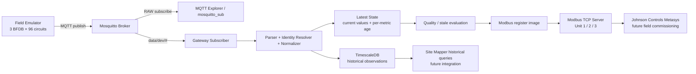
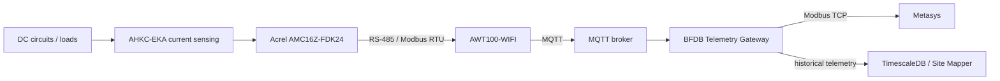

# BFDB Telemetry Gateway

Industrial telemetry gateway PoC that converts asynchronous MQTT telemetry from three BFDB domains into deterministic current state, historical time-series storage, and a read-only Modbus TCP interface intended for Johnson Controls Metasys.

> **Current status:** the fully emulated vertical slice is running and has been validated locally and through an external MQTT TCP tunnel. The PoC is **not yet field-closed**: real AMC16Z-FDK24/AWT100 substitution, physical identity mapping, failure-scenario certification, and Metasys commissioning remain open.

## Executive summary

The project solves one integration problem:

**Take electrical measurements arriving asynchronously over MQTT and make them available simultaneously as historical telemetry and as deterministic Modbus TCP registers.**

The target scale is:

- 3 BFDB;
- 96 circuits per BFDB;
- 4 electrical variables per circuit: Voltage, Current, Power, Energy;
- 288 circuits total;
- 1,152 logical telemetry values;
- 2,304 16-bit Modbus registers for the FLOAT32 telemetry block.

The platform intentionally separates **raw transport**, **current state**, **history**, and **industrial polling** so that no consumer is forced to depend on another consumer's access pattern.



### Core architectural rule

```text
MQTT       = asynchronous source / push
Latest State = current reconstructed state
TimescaleDB  = historical projection
Modbus TCP   = synchronous polling surface
```

**Modbus never synchronously queries MQTT or TimescaleDB.** It reads only the in-memory Latest State / register projection.

## Physical target context

The intended field chain is:



The emulator replaces the field source **above the broker boundary**. It does not claim complete vendor-device fidelity.

## What the emulator publishes

Three synthetic gateway serials are emitted:

```text
data/dev/EMU-BFDB-01
data/dev/EMU-BFDB-02
data/dev/EMU-BFDB-03
```

Payload shape follows the observed field pattern:

```json
{
  "msgid": "2289",
  "method": "update",
  "sn": "EMU-BFDB-03",
  "timestamp": 1790371605,
  "sendtime": 1790371605,
  "version": 1,
  "reported": {
    "0_1_25": {
      "state": "ONLINE",
      "U1": "13.82",
      "U2": "0.00",
      "I1": "3.46",
      "I2": "0.00",
      "P1": "47.83",
      "P2": "0.00",
      "EP1": "0.5074",
      "EP2": "0.00"
    }
  }
}
```

Topic and payload are separate MQTT concepts. The emulator publishes them independently; it does **not** wrap them into a synthetic `{"topic":...,"payload":...}` object.

The emulator rotates 24-point batches so that all 96 logical circuits are covered. Voltage/current/power/energy are generated coherently: power approximately follows `V × I`, and positive energy accumulates over time.

## Partial updates are first-class

Observed field traffic can be partial. A point may arrive as:

```json
{"state":"ONLINE"}
```

after previously carrying V/I/P/E.

Contract:

- missing field != zero;
- missing field = not updated;
- explicit `"0.00"` = real zero;
- Latest State merges per attribute;
- an older per-field timestamp cannot overwrite a newer value.

This distinction is critical for both Modbus output and historical semantics.

## Modbus contract

The baseline projection uses one TCP server with three logical Unit IDs:

| Unit ID | Logical device |
|---:|---|
| 1 | BFDB-01 |
| 2 | BFDB-02 |
| 3 | BFDB-03 |

Each circuit uses 8 consecutive 16-bit registers:

```text
base = (circuit - 1) * 8

base+0..1  Voltage  FLOAT32
base+2..3  Current  FLOAT32
base+4..5  Power    FLOAT32
base+6..7  Energy   FLOAT32
```

Circuit 1 occupies offsets 0-7; circuit 96 occupies 760-767.

Current PoC baseline:

- read-only;
- lab port `1502`;
- production port proposal `502`;
- FC04 Input Registers baseline, pending Metasys confirmation;
- IEEE-754 FLOAT32;
- high-word-first / big-endian baseline, pending commissioning confirmation.

See [ICD](docs/ICD.md) and [Modbus documentation](docs/06-modbus/).

## Current evidence

Validated on 2026-09-25:

- all three emulator topics continuously publish and are consumed by the gateway;
- TimescaleDB contains persisted telemetry for the three BFDB domains;
- Modbus TCP reads V/I/P/E successfully;
- raw MQTT was independently inspected with `mosquitto_sub`;
- a real state-only partial update was observed in the emulator stream;
- an external MQTT Explorer connected through a public TCP tunnel and received all three topic families.

Evidence and limitations are recorded in [lab-validation-2026-09-25.md](docs/01-evidence/lab-validation-2026-09-25.md).

## Status: what is done vs what is not


Automated/emulated coverage is strong through B9. B10 and B11 remain open. Failure-scenario certification and one TSDB historical-semantics correction also remain open.

See [Project status](docs/00-project/STATUS.md).

## Quick start — local lab

### Prerequisites

- Docker + Docker Compose;
- Python 3 for the local Modbus reader if executed outside the container stack.

Start:

```bash
cp .env.example .env
docker compose up --build
```

Default lab ports:

| Service | Port |
|---|---:|
| MQTT / Mosquitto | 1883 |
| PostgreSQL / TimescaleDB | 5432 |
| Modbus TCP lab | 1502 |

### Observe RAW MQTT

Local anonymous lab profile:

```bash
docker run --rm -it \
  --network bfdb-telemetry-gateway_default \
  eclipse-mosquitto:2.0 \
  mosquitto_sub \
  -h mosquitto \
  -p 1883 \
  -t 'data/dev/#' \
  -v
```

### Query historical telemetry

```bash
docker compose exec timescaledb \
  psql -U bfdb -d bfdb \
  -c "SELECT observed_at,bfdb_id,circuit_id,voltage_v,current_a,power_w,energy_kwh
      FROM telemetry_samples
      ORDER BY observed_at DESC
      LIMIT 20;"
```

### Read Modbus

Linux/WSL:

```bash
python3 tools/modbus-reader/read.py --host 127.0.0.1 --port 1502 --unit 1 --circuit 1
```

Windows PowerShell:

```powershell
python tools/modbus-reader/read.py --host 127.0.0.1 --port 1502 --unit 1 --circuit 1
```

## Secure remote MQTT review

For remote reviewers, use the authenticated broker profile. It creates separate MQTT identities:

- `bfdb-emulator`: publish-only to `data/dev/#`;
- `bfdb-gateway`: read-only from `data/dev/#`;
- `bfdb-reviewer`: read-only from `data/dev/#`.

Generate local secrets:

```bash
bash scripts/setup-ngrok-review.sh
```

Then:

```bash
docker compose --env-file .env.remote \
  -f docker-compose.yml \
  -f docker-compose.remote.yml \
  up -d --build
```

The current documented free external TCP review path uses an ephemeral Pinggy reverse TCP tunnel. Full instructions, alternatives, security constraints, and the meaning of the public random port are in [Remote MQTT access](docs/08-commissioning/remote-mqtt-access.md).

**Do not expose TimescaleDB or Modbus TCP to the public Internet for this review flow.**

## Repository layout

```text
apps/
├── field-emulator/        synthetic BFDB MQTT source
└── telemetry-gateway/     MQTT -> state/history/Modbus
config/                    device, emulator, quality, Modbus configuration
db/                        Timescale schema and queries
docs/                      contracts, architecture, tests, operations, commissioning
infra/mosquitto/           local and authenticated broker profiles
scripts/                   CI smoke and remote-review setup
tests/                     unit tests
tools/
├── modbus-reader/         direct Modbus TCP verification
└── tsdb-inspector/        historical verification
```

Start with the [documentation index](docs/README.md).

## Status taxonomy

Documentation uses these labels:

- **VERIFIED** — backed by specification/manual or repeatable verified system behavior;
- **OBSERVED** — directly seen in captures, logs, MQTT or lab execution;
- **DECISION** — architecture/product decision;
- **INFERENCE** — plausible interpretation not yet proven;
- **TBD** — requires field evidence or integrator confirmation.

This is especially important around real physical identity mapping. The emulator's `0_1_n -> circuit n` mapping is synthetic and **must not be treated as proof of the real device mapping**.

## Known open items

The repository intentionally documents unresolved items rather than hiding them:

- real serial -> BFDB mapping;
- real raw point -> physical circuit mapping;
- meaning of `0_1_n` vs `0_2_n` and U2/I2/P2/EP2;
- actual field QoS/session/reconnect behavior;
- TSDB partial-electrical observation semantics need refinement so carried-forward values are not falsely timestamped as newly observed;
- `sendtime` is parsed but not yet persisted as its own TSDB column;
- negative/failure scenarios exist in design but are not all executable/certified yet;
- database outage durability is not yet production-grade;
- health/metrics endpoints are not yet implemented;
- Metasys FC03/FC04, word order, polling, retries, stale policy and production network parameters remain commissioning TBDs.

## Safety boundary

This repository is currently a PoC/lab implementation. The local anonymous broker profile exists only for local development. The authenticated remote-review profile is safer, but plain MQTT over an ephemeral TCP tunnel is still **not** the final production security design.

Production hardening requires TLS/authentication, OT/IT segmentation, secrets management, observability, durable failure handling, and field commissioning.
