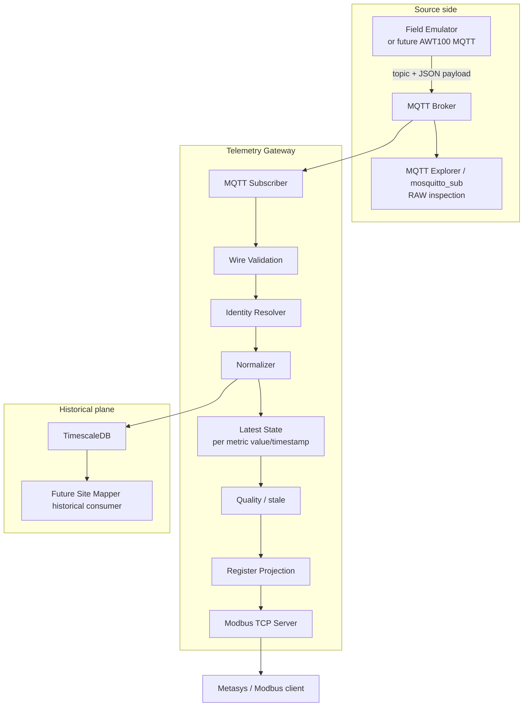
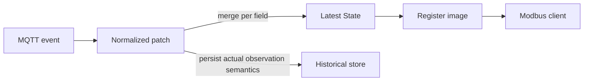
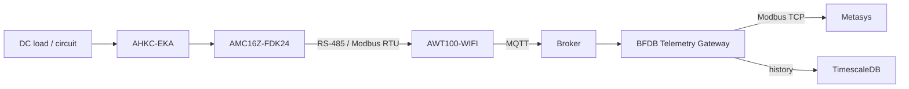

# System Overview

## Purpose

BFDB Telemetry Gateway bridges an asynchronous MQTT telemetry source into two independent read models:

1. **historical observations** in TimescaleDB;
2. **current deterministic values** exposed over Modbus TCP.

The design prevents a synchronous industrial protocol from depending directly on a streaming protocol.

## Logical architecture



## State ownership



### Latest State

Latest State answers: **what is the best current known value?**

It may retain a previous metric when a later MQTT patch omits that metric.

### Historical store

Historical storage answers: **what was actually observed, and when?**

It must not treat a carried-forward Latest State metric as newly sampled merely because another field changed.

This distinction is a known correction target in the current v0.1 persistence implementation. See [ingestion policy](../05-timeseries/ingestion-policy.md).

## Physical target chain



The physical chain is context for the target integration. The PoC currently substitutes the field source with the emulator.

## Capacity

| Dimension | Value |
|---|---:|
| BFDB | 3 |
| Circuits per BFDB | 96 |
| Total circuits | 288 |
| Metrics per circuit | 4 |
| Logical telemetry values | 1,152 |
| 16-bit registers per FLOAT32 value | 2 |
| Telemetry registers across 3 Unit IDs | 2,304 |

## MQTT boundary

Topic family:

```text
data/dev/<serial>
```

Payload family:

```json
{
  "msgid": "...",
  "method": "update",
  "sn": "...",
  "timestamp": 0,
  "sendtime": 0,
  "version": 1,
  "reported": {}
}
```

A message may contain a subset of points and a point may contain only a subset of attributes.

## Identity boundary

The gateway has an explicit Identity Resolver because the following remain unproven for real hardware:

- one gateway serial == one physical BFDB;
- `0_1_13` == physical circuit 13;
- exact meaning of `0_1_n` vs `0_2_n`.

The emulator uses a synthetic linear mapping only to exercise the complete 288-circuit system.

## Modbus boundary

One TCP endpoint projects three logical devices through Unit IDs 1/2/3. Each uses the same register map.

The current design assumes:

- read-only;
- FC04 baseline;
- FLOAT32;
- two 16-bit registers per value;
- 8 registers per circuit.

FC03/FC04 choice, word/byte order and polling policy require Metasys commissioning confirmation.

## Remote review boundary

External MQTT review exposes **only the MQTT broker path** and uses a read-only reviewer credential.

Do not expose:

- TimescaleDB 5432;
- Modbus 1502/502;
- Docker daemon;
- repository secrets.

See [Remote MQTT Access](../08-commissioning/remote-mqtt-access.md).
