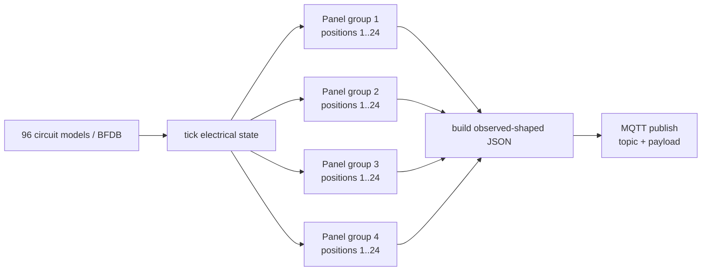

# Emulator Design

## Purpose

The emulator validates ingestion and projection contracts. It is **not** a claim of full Acrel/AWT vendor-device fidelity.

Success criterion:

> Replacing the emulator with real field MQTT should not require architectural redesign below the broker boundary.

## Scale

The emulator creates:

- 3 synthetic BFDB identities;
- 96 circuit models per BFDB;
- 288 circuits total;
- V/I/P/E for every synthetic circuit.

Synthetic serials:

```text
EMU-BFDB-01
EMU-BFDB-02
EMU-BFDB-03
```

## Corrected panelized identity model

The previous emulator flattened all 96 logical circuits under one family:

```text
0_1_1 ... 0_1_96
```

That was a modeling defect.

The corrected emulator respects a 24-position panel boundary:

```text
logical circuits  1..24  -> 0_1_1 .. 0_1_24
logical circuits 25..48  -> 0_2_1 .. 0_2_24
logical circuits 49..72  -> 0_3_1 .. 0_3_24
logical circuits 73..96  -> 0_4_1 .. 0_4_24
```

Thus:

```text
0_1_24  valid
0_2_1   valid
0_1_25  invalid
0_1_96  invalid
```

The emulator's group 3/4 naming is deliberately labeled **synthetic**. It allows the 96-circuit PoC to preserve 24-position boundaries, but it does not claim that real frame B is encoded by the AWT gateway as `0_3_*` and `0_4_*`.

## Publication model

- MQTT topic and payload are passed separately to the MQTT client;
- topic template: `data/dev/<serial>`;
- JSON values use observed field naming such as U1/I1/P1/EP1;
- numeric metric values are serialized as strings;
- 24 points are published per BFDB message;
- each 24-point batch aligns to one synthetic panel group;
- four batches cover 96 logical circuits;
- deterministic state-only partial patches are injected.



## Logical-circuit reconstruction

The gateway maps the panelized raw identity back to the stable logical circuit used by Latest State, TimescaleDB and Modbus:

```text
circuitId = ((panelIndex - 1) * 24) + position
```

Examples:

```text
0_1_24 -> Circuit 24
0_2_1  -> Circuit 25
0_3_1  -> Circuit 49
0_4_24 -> Circuit 96
```

This preserves the existing 96-circuit Modbus contract while fixing the MQTT representation.

## Electrical coherence

The emulator does not independently randomize all four metrics.

Conceptually:

```text
Voltage(t) = nominal DC level + small variation
Current(t) = load profile / smooth variation
Power(t)   ≈ Voltage(t) × Current(t)
Energy(t) += Power(t) × elapsed time
```

Positive consumption energy should not randomly decrease.

## Partial update semantics

A configured publication may replace one point in a batch with:

```json
{"state":"ONLINE"}
```

This intentionally exercises the gateway rule:

```text
missing metric != zero
```

The partial update uses the same panelized point-id encoder as full points.

## U1/U2 suffix boundary

The topology review also discusses possible relationships between U1/I1/P1/EP1 and U2/I2/P2/EP2 and internal 12-channel sections.

That interpretation is **not implemented as physical truth yet**, because the available mapping discussion contains hypotheses that still require a focused field test.

This correction therefore changes only the point-id panel boundary that is sufficiently clear for the emulator:

```text
third component <= 24
```

It does not silently redefine U1/U2 physical semantics.

## msgid behavior

The current emulator uses one global monotonic counter across all three synthetic serials, so a single BFDB can appear to advance by three between its own messages.

Example:

```text
BFDB-01 -> 2263
BFDB-02 -> 2264
BFDB-03 -> 2265
BFDB-01 -> 2266
...
```

This is acceptable for the current PoC but is not a claim about real gateway `msgid` scope. Per-device counters may be introduced if field evidence supports that model.

## Scenario status

Scenario names/design exist for:

- NORMAL_LOAD;
- ZERO_LOAD;
- LOAD_STEP;
- REVERSE_FLOW;
- OFFLINE;
- STALE;
- PARTIAL;
- MALFORMED;
- RECONNECT.

The current executable path strongly covers normal load and partial-update behavior. The remaining scenarios still require full executable/E2E certification.
