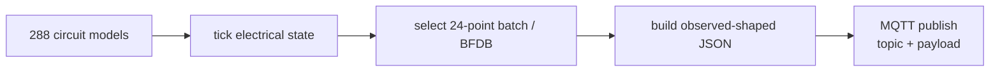

# Emulator Design

## Purpose

The emulator validates ingestion and projection contracts. It is **not** a claim of full Acrel/AWT vendor-device fidelity.

Success criterion:

> Replacing the emulator with real field MQTT should not require architectural redesign below the broker boundary.

## Scale

The emulator creates:

- 3 synthetic BFDB identities;
- 96 circuit models per BFDB;
- 288 circuits total;
- V/I/P/E for every synthetic circuit.

Synthetic serials:

```text
EMU-BFDB-01
EMU-BFDB-02
EMU-BFDB-03
```

## Publication model

- MQTT topic and payload are passed separately to the MQTT client;
- topic template: `data/dev/<serial>`;
- JSON values use observed field naming such as U1/I1/P1/EP1;
- numeric metric values are serialized as strings;
- 24 points are published per BFDB message;
- batches rotate through all 96 circuits;
- deterministic state-only partial patches are injected.



## Electrical coherence

The emulator does not independently randomize all four metrics.

Conceptually:

```text
Voltage(t) = nominal DC level + small variation
Current(t) = load profile / smooth variation
Power(t)   ≈ Voltage(t) × Current(t)
Energy(t) += Power(t) × elapsed time
```

Positive consumption energy should not randomly decrease.

## Partial update semantics

A configured publication may replace one point in a batch with:

```json
{"state":"ONLINE"}
```

This intentionally exercises the gateway rule:

```text
missing metric != zero
```

## Identity mapping

The emulator currently uses a synthetic linear resolver such as:

```text
0_1_1  -> synthetic circuit 1
...
0_1_96 -> synthetic circuit 96
```

This is a **test mapping only**.

It must not be used as evidence that real `0_1_n` identifiers correspond directly to physical circuit numbers.

## msgid behavior

Current v0.1 uses one global monotonic counter across all three synthetic serials, so a single BFDB can appear to advance by three between its own messages.

Example:

```text
BFDB-01 -> 2263
BFDB-02 -> 2264
BFDB-03 -> 2265
BFDB-01 -> 2266
...
```

This is acceptable for the current PoC but is not a claim about real gateway `msgid` scope. Per-device counters may be introduced if field evidence supports that model.

## Scenario status

Scenario names/design exist for:

- NORMAL_LOAD;
- ZERO_LOAD;
- LOAD_STEP;
- REVERSE_FLOW;
- OFFLINE;
- STALE;
- PARTIAL;
- MALFORMED;
- RECONNECT.

The current executable path strongly covers normal load and partial-update behavior. The remaining scenarios still require full executable/E2E certification.
