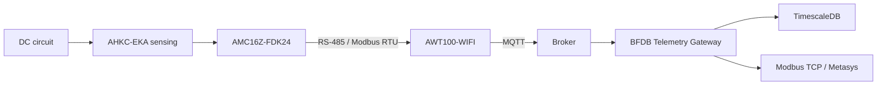

# Real Hardware Integration Dossier — AMC16Z-FDK24 / AWT100

Status: **DOCUMENTED / FIELD VALIDATION PENDING**

## Purpose

Define exactly how the emulator is replaced by real Acrel/AWT MQTT without redesigning the downstream gateway.

## Target physical chain



## Known topology model

Current reviewed model:

```text
BFDB
├── Frame A
│   ├── Panel A1 — 24 positions
│   ├── Panel A2 — 24 positions
│   └── optional A3 — 24 positions
└── Frame B
    ├── Panel B1 — 24 positions
    ├── Panel B2 — 24 positions
    └── optional B3 — 24 positions
```

The current PoC target uses 96 logical circuits total.

## Evidence-backed constraint

A single panel/measurement group is treated as having **24 positions**.

Therefore a raw point identity whose final position is greater than 24 is rejected by the corrected emulator profile.

## Facts still requiring field evidence

Do not infer these:

```text
real serial -> BFDB
raw group number -> physical panel
raw point -> physical breaker/circuit
frame B namespace
U1/U2 physical channel semantics
I1/I2 physical channel semantics
P1/P2 physical channel semantics
EP1/EP2 physical channel semantics
real publish cadence
QoS/session/reconnect behavior
source clock behavior
```

## Field substitution procedure

### 1. Capture broker traffic before gateway changes

Subscribe to:

```text
data/dev/#
```

Record:
- topic;
- serial;
- msgid;
- timestamp;
- sendtime;
- reported keys;
- point payloads.

### 2. Build serial inventory

For every observed serial record:

```text
serial:
physical BFDB:
frame:
AWT location:
RS-485 downstream devices:
evidence source:
confidence:
```

### 3. Build raw-point inventory

For each raw group/point:

```text
raw_point_id:
physical panel:
physical position:
logical circuit:
evidence:
confidence:
```

### 4. Perform controlled-load mapping

Use a known circuit and a known DC load.

Observe which raw field changes.

Repeat at minimum for:
- channel/position 1;
- 12;
- 13;
- 24;
- first position of the next panel.

This is specifically intended to resolve whether suffix families represent internal sections or a different mapping.

### 5. Freeze identity configuration

Only after evidence exists, replace the synthetic emulator identity configuration with a real profile.

Production behavior must be configuration-driven rather than hard-coded inference.

## Hardware acceptance checklist

```text
[ ] AWT serial inventory complete
[ ] AMC address inventory complete
[ ] Panel A/B inventory complete
[ ] 24-position boundaries verified
[ ] Known physical circuit traced to RAW MQTT
[ ] U1/U2 semantics verified
[ ] state ONLINE/OFFLINE meaning verified
[ ] Publish cadence measured
[ ] Reconnect behavior observed
[ ] Duplicate/out-of-order behavior observed
[ ] Source timestamps checked
[ ] Real profile committed
[ ] Emulator remains available for lab regression
```

## Evidence storage

Field evidence should be stored under:

```text
docs/01-evidence/
```

with:
- date;
- site;
- hardware serials;
- capture method;
- observed data;
- conclusion;
- unresolved items.

## Exit criterion

The hardware integration gate closes only when a known physical circuit can be traced:

```text
physical circuit
-> sensor/AMC
-> AWT serial/raw point
-> MQTT
-> normalized logical circuit
-> Timescale
-> Modbus
```

without relying on an inferred mapping.
