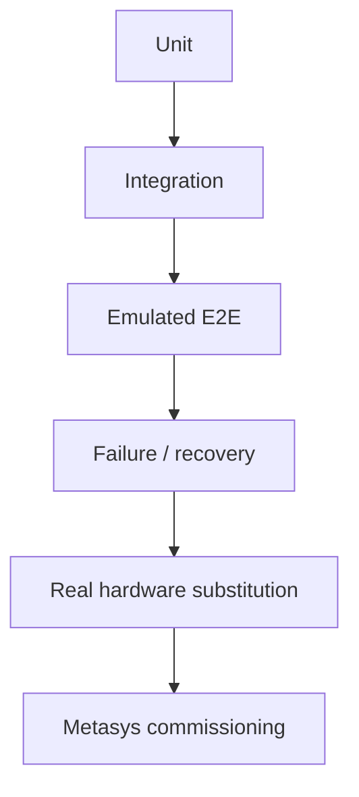

# Test Strategy

## Test layers



## Unit

- electrical power coherence;
- monotonic positive energy;
- partial merge;
- explicit zero vs missing;
- out-of-order rejection;
- parser topic/serial validation;
- FLOAT32 encode/decode;
- register boundaries;
- Modbus context addressing.

## Integration

- MQTT publish/subscribe;
- parser + identity resolution;
- Timescale persistence/dedupe;
- Modbus register projection;
- authenticated broker ACL profile.

## E2E happy path

For the same BFDB/circuit:

1. observe RAW MQTT;
2. identify exact point/circuit;
3. query corresponding TSDB row;
4. read corresponding Modbus Unit ID/circuit;
5. compare V/I/P/E within source rounding/FLOAT32 tolerance.

If values are moving continuously, pause the emulator for a deterministic snapshot comparison.

## RAW external certification

An independent remote MQTT Explorer must connect through the configured remote-review path and observe:

```text
data/dev/EMU-BFDB-01
data/dev/EMU-BFDB-02
data/dev/EMU-BFDB-03
```

This proves broker-level external visibility independently of gateway/DB/Modbus.

## Partial-update certification

Required sequence:

1. observe a complete point;
2. emit/observe a state-only patch for the same point;
3. confirm Latest State retains V/I/P/E;
4. confirm explicit zero still overwrites a metric;
5. confirm Modbus preserves the last-known numeric values;
6. confirm historical storage does not falsely mark carried-forward metrics as newly observed.

Step 6 remains a known implementation correction target.

## Negative paths

Must be demonstrably executable/certified:

- malformed payload;
- missing attributes;
- explicit zero;
- duplicate message;
- out-of-order observation;
- stale source;
- OFFLINE state;
- broker disconnect/reconnect;
- process restart;
- database outage;
- queue saturation behavior;
- reverse-flow values.

## Field substitution

The emulator is removed and real MQTT is introduced without redesign below the broker boundary.

Required evidence:

- real serial mapping;
- raw point mapping;
- source cadence;
- partial-update behavior;
- timestamp behavior;
- reconnect behavior.

## Metasys commissioning

Verify:

- Unit IDs;
- FC03/FC04;
- register addresses;
- known FLOAT32 vector;
- byte/word order;
- polling interval;
- timeout/retries;
- stale/invalid behavior.

## Evidence rule

Every passed gate must have repeatable evidence: logs, query output, client read, capture, automated test, or commissioning record.

See [2026-09-25 lab evidence](../01-evidence/lab-validation-2026-09-25.md).
