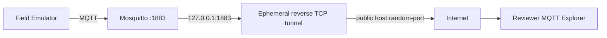

# Remote MQTT Access — Direct TCP Review

## Goal

Allow another person to use **their own MQTT client / MQTT Explorer Desktop** to receive the exact broker data produced by the BFDB emulator.

This is different from publishing a web UI. The reviewer must reach the MQTT broker over TCP.



## Security model

Use the authenticated remote profile, not the anonymous local lab broker.

Accounts:

| Account | Permission |
|---|---|
| `bfdb-emulator` | publish to `data/dev/#` |
| `bfdb-gateway` | read `data/dev/#` |
| `bfdb-reviewer` | read `data/dev/#` |

The reviewer account must not publish telemetry.

### Secrets that must never be shared

- emulator password;
- gateway password;
- `.env.remote`;
- Mosquitto password file;
- any provider account token/authtoken;
- repository credentials.

Only share the reviewer MQTT username/password and the temporary public host/port.

## 1. Generate MQTT credentials

From WSL/Linux:

```bash
bash scripts/setup-ngrok-review.sh
```

Despite the historical script name, it generates **broker credentials** and is not tied to ngrok.

It creates:

```text
.env.remote
infra/mosquitto/secrets/passwd
```

Both paths are ignored by Git.

If Windows checkout line endings break the shell script:

```bash
sed -i 's/\r$//' scripts/setup-ngrok-review.sh
bash scripts/setup-ngrok-review.sh
```

The repository includes `.gitattributes` to force LF line endings for shell scripts.

## 2. Start the authenticated broker profile

```bash
docker compose --env-file .env.remote \
  -f docker-compose.yml \
  -f docker-compose.remote.yml \
  up -d --build
```

Always include `--env-file .env.remote` with the remote compose profile. Otherwise Docker Compose will warn that MQTT password variables are unset.

Verify:

```bash
docker compose --env-file .env.remote \
  -f docker-compose.yml \
  -f docker-compose.remote.yml \
  ps
```

## 3. Verify locally before exposing anything

Load the generated variables into the shell:

```bash
set -a
source .env.remote
set +a
```

Subscribe directly inside the Docker network:

```bash
docker run --rm -it \
  --network bfdb-telemetry-gateway_default \
  eclipse-mosquitto:2.0 \
  mosquitto_sub \
  -h mosquitto \
  -p 1883 \
  -u bfdb-reviewer \
  -P "$MQTT_REVIEWER_PASSWORD" \
  -t 'data/dev/#' \
  -v
```

Expected topics:

```text
data/dev/EMU-BFDB-01
data/dev/EMU-BFDB-02
data/dev/EMU-BFDB-03
```

## 4. Full-free lab path used on 2026-09-25: Pinggy TCP

Start an unauthenticated free reverse TCP tunnel:

```bash
ssh -p 443 -R0:127.0.0.1:1883 tcp@free.pinggy.io
```

The service returns an endpoint similar to:

```text
tcp://example.run.pinggy-free.link:36771
```

The exact hostname and port are temporary.

### Why is the public port not 1883?

The command uses:

```text
-R0:127.0.0.1:1883
  ^
  0 = request any available remote port
```

So the mapping is:

```text
public-host:36771
        |
        | reverse TCP tunnel
        v
127.0.0.1:1883
        |
        v
Mosquitto
```

The broker still listens locally on port 1883. `36771` was only the public port randomly allocated for one tunnel session.

A new tunnel may receive a different host and port.

### Observed free-tier behavior

During the 2026-09-25 lab session, the unauthenticated free tunnel explicitly reported:

```text
Your tunnel will expire in 60 minutes.
```

Treat the endpoint as ephemeral and disposable.

## 5. Reviewer MQTT Explorer configuration

For an endpoint:

```text
tcp://example.run.pinggy-free.link:36771
```

configure MQTT Explorer as:

```text
Protocol: mqtt://
Host:     example.run.pinggy-free.link
Port:     36771

Username: bfdb-reviewer
Password: <MQTT_REVIEWER_PASSWORD>

SSL/TLS: OFF
Path:    empty / not applicable
```

Do **not** select:

```text
wss://
Path /mqtt
```

because this tunnel is raw TCP carrying native MQTT, not MQTT-over-WebSocket.

Subscribe to:

```text
data/dev/#
```

Expected topic tree:

```text
data
└── dev
    ├── EMU-BFDB-01
    ├── EMU-BFDB-02
    └── EMU-BFDB-03
```

## 6. Stop access

Stop the tunnel session:

```text
Ctrl+C
```

The public endpoint becomes unusable.

If reviewer credentials should be rotated, rerun the credential-generation script and restart the authenticated compose profile.

## Alternatives evaluated

### ngrok TCP

In the 2026-09-25 lab account, `ngrok tcp 1883` returned `ERR_NGROK_8013` and required adding a credit/debit card before free-account TCP endpoints could be used.

This is why the lab switched to Pinggy for a no-card test.

### Cloudflare Quick Tunnel

A Quick Tunnel successfully produced an HTTPS `trycloudflare.com` URL for a local HTTP service, but that does **not** give a remote MQTT Explorer a native raw TCP MQTT endpoint.

It is useful when sharing a web application, not for the direct MQTT Desktop-client requirement used in this test.

### Private overlay network

A private overlay such as Tailscale is another option when both parties can install a client. It avoids a public broker endpoint but changes the reviewer setup model.

## Security limitations

The current lab remote path is:

```text
native MQTT
+ username/password
+ broker ACL
+ ephemeral public TCP tunnel
```

It is **not** the final production security design.

Plain MQTT on this path does not provide application-layer TLS between reviewer and broker. Production must use a deliberately approved encrypted design such as MQTTS/TLS and the required OT/IT network controls.

## Never expose for this review

Do not tunnel:

- PostgreSQL / TimescaleDB `5432`;
- Modbus TCP `1502` or `502`;
- Docker daemon;
- SSH to the host;
- any secrets-management surface.

The remote review requirement is only to observe MQTT telemetry.
