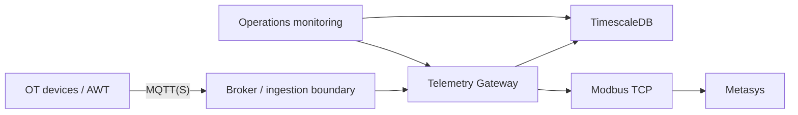

# Production Operations Runbook

Status: **DOCUMENTED BASELINE / DEPLOYMENT APPROVAL PENDING**

This document defines the operational shape expected before production deployment.

It does not claim that the current PoC already satisfies every production control.

## Production principles

The production deployment must preserve these invariants:

```text
MQTT source asynchronous
Latest State independent
Timescale history independent
Modbus served from in-memory projection
Modbus read-only
Secrets outside Git
No public Modbus
No public database
Encrypted/authenticated MQTT where approved
Explicit device identity configuration
```

## Deployment topology

Recommended logical zones:



Actual VLANs/firewalls/IPs are deployment-specific and must be recorded during commissioning.

## Pre-deployment checklist

```text
[ ] release commit identified
[ ] CI green
[ ] integration smoke green
[ ] release validation receipt complete
[ ] field identity profile approved
[ ] Metasys ICD values signed off
[ ] secrets provisioned outside Git
[ ] TLS/security architecture approved
[ ] firewall rules reviewed
[ ] database backup target configured
[ ] monitoring/alerting configured
[ ] rollback plan tested
[ ] operations owner assigned
```

## Configuration

Never embed production secrets in:
- repository files;
- Docker image layers;
- command history where avoidable;
- screenshots/tickets.

Production environment must define:
- broker endpoint/auth;
- DB endpoint/auth;
- Modbus bind address/port;
- stale threshold;
- device identity profile.

## Start

Exact orchestration depends on the approved runtime platform.

Required startup order:

```text
1. database available
2. broker/network available
3. gateway starts
4. gateway reaches DB
5. gateway subscribes MQTT
6. Modbus listener starts
7. health/monitoring confirms readiness
```

## Readiness checks

Minimum:

```text
MQTT connected
TSDB connected
recent source message observed
Latest State populated
Modbus listener active
no identity rejection storm
no queue saturation
no sustained decode errors
```

## Routine operational checks

Daily/shift-level:
- source freshness;
- broker connection;
- DB connectivity;
- DB disk usage;
- ingest error count;
- stale circuit count;
- Modbus request error/timeout count;
- application restart count.

## Incident: MQTT source lost

Expected behavior:
- keep last-known numeric values;
- transition quality to STALE/INVALID per policy;
- Modbus remains responsive;
- no fabricated zero values.

Actions:
1. confirm broker connectivity;
2. confirm source device connectivity;
3. inspect last message timestamp;
4. inspect serial/topic;
5. do not restart blindly before preserving logs.

## Incident: TimescaleDB unavailable

Current PoC limitation:
- durable replay for the triggering observation is not yet guaranteed.

Production requirement:
- durable buffering/replay or equivalent must be implemented and verified before production approval.

Actions:
1. restore DB connectivity;
2. verify gateway reconnect;
3. inspect data gap;
4. record incident window;
5. reconcile/replay if supported.

## Incident: Modbus unavailable

Check:
- process/listener state;
- bind interface;
- port conflict;
- firewall;
- client Unit ID/function code;
- resource saturation.

Do not expose port 502 publicly as a troubleshooting shortcut.

## Rollback

Rollback must be release-based.

Record:
```text
current release commit
target rollback commit/tag
database schema compatibility
config compatibility
identity profile compatibility
```

A rollback must not silently revert a proven field identity mapping.

## Backup / restore

TimescaleDB production deployment must define:
- backup cadence;
- retention;
- backup storage;
- restore test cadence;
- recovery owner.

A backup strategy is not considered operational until a restore has been tested.

## Shutdown

Controlled shutdown:
1. stop accepting external maintenance changes;
2. capture health/state;
3. stop gateway;
4. stop broker only if owned by this deployment;
5. stop database only if required.

## Security

Production must not reuse the Pinggy lab flow.

The Pinggy workflow is commissioning/review tooling only.

## Production exit criteria

Production readiness requires all of:
- real hardware identity closed;
- Metasys commissioning closed;
- durable DB outage strategy closed;
- health/metrics implemented;
- production security/TLS approved;
- backup/restore tested;
- SLO/alerting in place;
- rollback tested.
